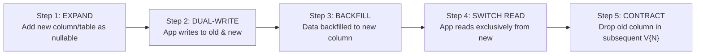

# Database Design & Flyway Sequential Migrations

This reference manual provides production database guidelines for PostgreSQL and Spring Data JPA, with strict emphasis on **Flyway sequential increment versioning**.

---

## 1. Flyway Versioning: STRICTLY Sequential Increments

### 1.1 Inviolable Rule: Sequential Increments Only

In the Occupify ecosystem, all Flyway migration scripts MUST use strictly sequential increment numbers:

```
src/main/resources/db/migration/
├── V1__init_schema.sql
├── V2__add_device_tokens_table.sql
├── V3__add_channel_index_to_notifications.sql
└── V4__add_scheduled_at_column.sql
```

### 1.2 Strict Prohibition of Timestamp Versioning

> [!CAUTION]
> **Timestamp-based migration filenames (e.g. `V20261008143000__create_table.sql`) are STRICTLY PROHIBITED.**

**Why timestamp versioning is rejected in Occupify:**
1. **Version Drift**: When developers work on parallel branches with different timestamps, merging PRs creates non-deterministic execution sequences on target environments.
2. **Audit Obscurity**: It is impossible to tell at a glance if a service has 4 migrations or 40 migrations when versions look like `V20261005120000`, `V20261007091500`, etc.
3. **Deterministic Rollbacks & Repairs**: Sequential numbers (`V1`, `V2`, `V3`) make it immediately obvious if a migration was skipped, misplaced, or failed in CI.

### 1.3 How to Create a New Migration
1. Check existing migrations:
   ```bash
   ls -1 src/main/resources/db/migration/
   ```
2. Identify the highest current version `V{N}`.
3. Name the new migration `V{N+1}__<snake_case_description>.sql` (e.g., if `V2__...` is highest, name new script `V3__...`).
4. Never modify an already executed migration file in Git. If a change is needed, author `V{N+1}__...`.

---

## 2. Non-Destructive Expand and Contract Pattern

All schema evolutions must be backward-compatible to allow zero-downtime rolling deployments.



### Example: Renaming or Replacing a Column Safely
1. **Migration `V3__add_display_name_column.sql`**:
   ```sql
   ALTER TABLE users ADD COLUMN IF NOT EXISTS display_name VARCHAR(100);
   ```
2. **Application Release**: Code writes to both `full_name` and `display_name`, reads from `display_name` if present.
3. **Migration `V4__backfill_display_name.sql`**:
   ```sql
   UPDATE users SET display_name = full_name WHERE display_name IS NULL;
   ```
4. **Migration `V5__contract_remove_legacy_full_name.sql`** (Released after all instances are upgraded):
   ```sql
   ALTER TABLE users DROP COLUMN IF EXISTS full_name;
   ```

---

## 3. PostgreSQL Schema & DDL Best Practices

1. **Primary Keys**: Use `UUID` generated via `gen_random_uuid()` or sequential `BIGSERIAL` / `IDENTITY`. Prefer UUID for distributed microservice entities to avoid ID enumeration attacks.
2. **Timestamps**: Always use `TIMESTAMP WITH TIME ZONE` (or `TIMESTAMPTZ`), never `TIMESTAMP WITHOUT TIME ZONE`.
3. **Monetary Values**: Always use `NUMERIC(14, 2)` or `NUMERIC(18, 4)`. Never use `FLOAT` or `DOUBLE` for financial amounts.
4. **Naming Conventions**:
   - Table names: plural, lowercase snake_case (`users`, `notifications`, `property_listings`).
   - Column names: lowercase snake_case (`user_id`, `created_at`, `is_active`).
   - Foreign key constraints: `fk_<table_name>_<referenced_table>`.
   - Indexes: `idx_<table_name>_<column_name>`.

```sql
CREATE TABLE IF NOT EXISTS notifications (
    id UUID PRIMARY KEY DEFAULT gen_random_uuid(),
    recipient_id UUID NOT NULL,
    type VARCHAR(50) NOT NULL,
    title VARCHAR(255) NOT NULL,
    content TEXT NOT NULL,
    channel VARCHAR(30) NOT NULL DEFAULT 'IN_APP',
    is_read BOOLEAN NOT NULL DEFAULT FALSE,
    read_at TIMESTAMP WITH TIME ZONE,
    created_at TIMESTAMP WITH TIME ZONE NOT NULL DEFAULT CURRENT_TIMESTAMP,
    updated_at TIMESTAMP WITH TIME ZONE NOT NULL DEFAULT CURRENT_TIMESTAMP
);

CREATE INDEX IF NOT EXISTS idx_notifications_recipient_id ON notifications(recipient_id);
CREATE INDEX IF NOT EXISTS idx_notifications_recipient_unread ON notifications(recipient_id, is_read) WHERE is_read = FALSE;
```

---

## 4. JPA Entity Architecture

### 4.1 Annotation Hygiene
- **PROHIBIT Lombok `@Data`** on `@Entity`: `@Data` generates `equals`, `hashCode`, and `toString` that eagerly evaluate lazy collections, causing `LazyInitializationException` or heap exhaustion loops.
- **ENFORCE**:
  ```java
  @Getter
  @Setter
  @NoArgsConstructor
  @AllArgsConstructor
  @Builder
  @Entity
  @Table(name = "notifications")
  public class Notification {

      @Id
      @GeneratedValue(strategy = GenerationType.UUID)
      private UUID id;

      @Column(name = "recipient_id", nullable = false)
      private UUID recipientId;

      @Enumerated(EnumType.STRING)
      @Column(name = "type", nullable = false, length = 50)
      private NotificationType type;

      @Column(name = "title", nullable = false, length = 255)
      private String title;

      @Column(name = "content", nullable = false, columnDefinition = "TEXT")
      private String content;

      @Column(name = "is_read", nullable = false)
      private boolean read;

      @CreationTimestamp
      @Column(name = "created_at", nullable = false, updatable = false)
      private Instant createdAt;

      @UpdateTimestamp
      @Column(name = "updated_at", nullable = false)
      private Instant updatedAt;

      @Override
      public boolean equals(Object o) {
          if (this == o) return true;
          if (!(o instanceof Notification other)) return false;
          return id != null && id.equals(other.id);
      }

      @Override
      public int hashCode() {
          return getClass().hashCode();
      }
  }
  ```

---

## 5. Transaction Boundary Rules

1. **Service Class Level**: Annotate class with `@Transactional(readOnly = true)` to make all queries read-only by default, reducing Hibernate dirty-checking overhead.
2. **Mutations**: Annotate mutating methods with `@Transactional`.
3. **No External Network Calls Inside Transactions**: Never call slow external REST APIs, payment gateways, or email servers inside a `@Transactional` boundary. This ties up database connection pool threads and leads to connection starvation.
