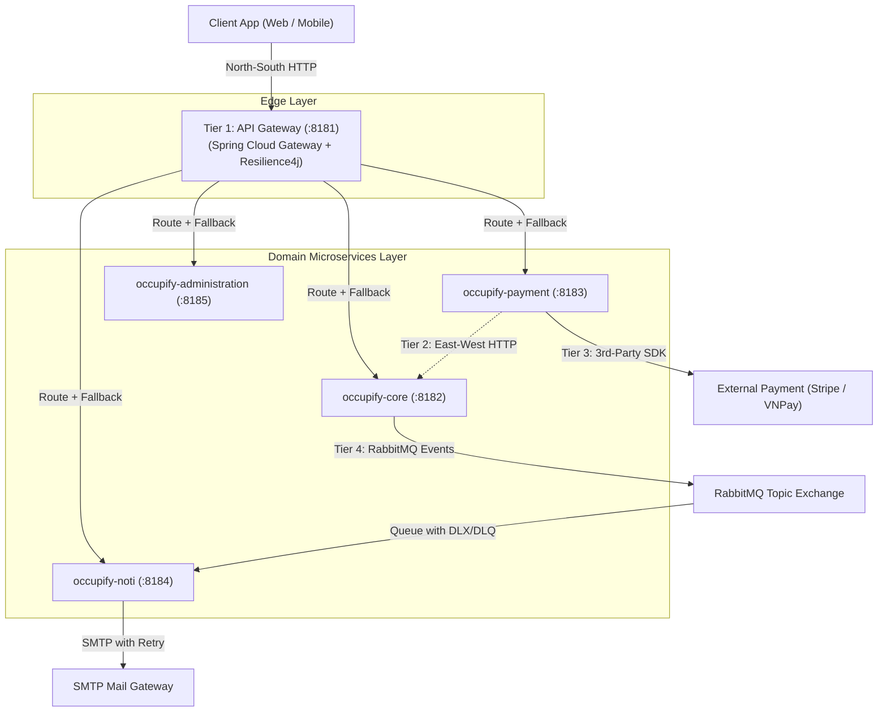
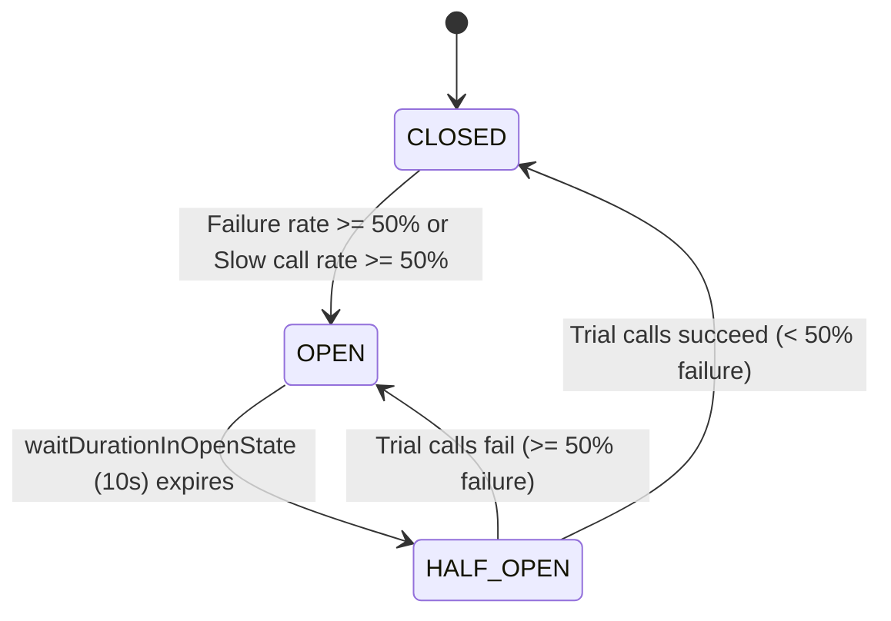

# Fault Tolerance & Resilience Architecture (Circuit Breaker & Retry)

This reference manual specifies the comprehensive, defense-in-depth resilience architecture for the **Occupify** microservices platform, covering **Spring Cloud Gateway**, **Resilience4j**, **Spring Retry**, and **RabbitMQ**.

---

## 1. System Overview: The 4-Tier Defense-in-Depth Model

A common microservices antipattern is implementing circuit breakers and retries solely at the API Gateway. In a distributed topology, failures propagate across multiple communication channels. Occupify mandates a **4-Tier Defense-in-Depth** resilience model:



### The 4 Resilience Tiers Matrix

| Tier | Communication Scope | Primary Threats | Implemented Technologies | Enforced Rules |
| :--- | :--- | :--- | :--- | :--- |
| **Tier 1** | **North-South (Ingress)**<br>Client $\rightarrow$ API Gateway $\rightarrow$ Microservices | Microservice crash, container restarts, gateway thread pool exhaustion. | Spring Cloud Gateway, Resilience4j Reactive, Gateway Retry. | Fail-fast on dead services, 503/504 fallback contracts, retries restricted to idempotent `GET`/`HEAD`. |
| **Tier 2** | **East-West (Inter-Service)**<br>Microservice $\rightarrow$ Microservice | Cascading service failure, slow dependency eating thread pools. | Resilience4j `@CircuitBreaker`, `@TimeLimiter`, Spring 6 `RestClient`. | Circuit breakers on all inter-service HTTP clients, typed fallbacks, distributed correlation ID propagation. |
| **Tier 3** | **3rd-Party Integrations**<br>Microservice $\rightarrow$ External API | Payment gateway latency spikes, webhook failures, cloud API outages. | Resilience4j `@Bulkhead`, `@Retry` with Jitter, `@CircuitBreaker`. | Bulkhead thread isolation, exponential backoff with full jitter, idempotency keys on payment operations. |
| **Tier 4** | **Event-Driven & Async**<br>RabbitMQ Consumers, SMTP | Poison pill messages, message crash loops, SMTP transient socket drops. | Spring AMQP Retry, Dead Letter Exchange (`DLX`/`DLQ`), `@Retryable`. | Idempotent consumers with Redis deduplication, 3 container retries, unrecoverable messages routed to DLQ. |

---

## 2. Tier 1: API Gateway Resilience (`occupify-identity`)

The API Gateway is the edge protector for all downstream microservices.

### 2.1 Circuit Breaker State Machine

Resilience4j operates as a finite state machine:
- **CLOSED**: Traffic flows normally. Request outcomes (success/failure/slow) are recorded in a sliding window.
- **OPEN**: If the failure or slow-call rate exceeds the threshold, the circuit trips to `OPEN`. All incoming requests immediately fail fast or forward to fallback without touching downstream containers.
- **HALF-OPEN**: After a configured wait duration, the circuit transitions to `HALF-OPEN` and permits a limited trial batch of probe requests. If the probe passes, it resets to `CLOSED`; if it fails, it trips back to `OPEN`.



### 2.2 Maven Dependencies

In `occupify-identity/pom.xml`:
```xml
<!-- Spring Cloud Reactive Circuit Breaker (Resilience4j) -->
<dependency>
    <groupId>org.springframework.cloud</groupId>
    <artifactId>spring-cloud-starter-circuitbreaker-reactor-resilience4j</artifactId>
</dependency>
```

### 2.3 Programmatic Customizer (`Resilience4jConfig`)

```java
package com.occupify.identity.config;

import io.github.resilience4j.circuitbreaker.CircuitBreakerConfig;
import io.github.resilience4j.timelimiter.TimeLimiterConfig;
import org.springframework.cloud.circuitbreaker.resilience4j.ReactiveResilience4JCircuitBreakerFactory;
import org.springframework.cloud.circuitbreaker.resilience4j.Resilience4JConfigBuilder;
import org.springframework.cloud.client.circuitbreaker.Customizer;
import org.springframework.context.annotation.Bean;
import org.springframework.context.annotation.Configuration;

import java.time.Duration;

@Configuration
public class Resilience4jConfig {

    @Bean
    public Customizer<ReactiveResilience4JCircuitBreakerFactory> defaultCircuitBreakerCustomizer() {
        return factory -> factory.configureDefault(id -> new Resilience4JConfigBuilder(id)
                .circuitBreakerConfig(CircuitBreakerConfig.custom()
                        .slidingWindowType(CircuitBreakerConfig.SlidingWindowType.COUNT_BASED)
                        .slidingWindowSize(10)
                        .minimumNumberOfCalls(5)
                        .failureRateThreshold(50.0f)
                        .slowCallRateThreshold(50.0f)
                        .slowCallDurationThreshold(Duration.ofSeconds(3))
                        .waitDurationInOpenState(Duration.ofSeconds(10))
                        .permittedNumberOfCallsInHalfOpenState(3)
                        .automaticTransitionFromOpenToHalfOpenEnabled(true)
                        .build())
                .timeLimiterConfig(TimeLimiterConfig.custom()
                        .timeoutDuration(Duration.ofSeconds(5))
                        .build())
                .build());
    }
}
```

### 2.4 Gateway Route Configuration (`application.yml`)

Every downstream route must configure both **Retry** and **CircuitBreaker** filters:

```yaml
spring:
  cloud:
    gateway:
      routes:
        # Core Marketplace Service (:8182)
        - id: core-service
          uri: ${SERVICES_CORE_URL:http://localhost:8182}
          predicates:
            - Path=/projects/**, /applications/**, /reviews/**, /bids/**
          filters:
            # 1. Gateway Retry Filter (Executed before circuit breaker)
            - name: Retry
              args:
                retries: 3
                statuses: BAD_GATEWAY, SERVICE_UNAVAILABLE, GATEWAY_TIMEOUT
                methods: GET, HEAD   # Strictly idempotent methods only!
                backoff:
                  firstBackoff: 100ms
                  maxBackoff: 1000ms
                  factor: 2
                  basedOnPreviousValue: true
            # 2. Circuit Breaker Filter
            - name: CircuitBreaker
              args:
                name: coreCircuitBreaker
                fallbackUri: forward:/fallback/core

resilience4j:
  circuitbreaker:
    configs:
      default:
        slidingWindowType: COUNT_BASED
        slidingWindowSize: 10
        minimumNumberOfCalls: 5
        failureRateThreshold: 50
        slowCallRateThreshold: 50
        slowCallDurationThreshold: 3000ms
        waitDurationInOpenState: 10000ms
        permittedNumberOfCallsInHalfOpenState: 3
        automaticTransitionFromOpenToHalfOpenEnabled: true
    instances:
      coreCircuitBreaker:
        baseConfig: default
      paymentCircuitBreaker:
        baseConfig: default
      notificationCircuitBreaker:
        baseConfig: default
      adminCircuitBreaker:
        baseConfig: default
  timelimiter:
    configs:
      default:
        timeoutDuration: 5000ms
    instances:
      coreCircuitBreaker:
        baseConfig: default
      paymentCircuitBreaker:
        baseConfig: default
      notificationCircuitBreaker:
        baseConfig: default
      adminCircuitBreaker:
        baseConfig: default
```

> [!CAUTION]
> **Idempotency Rule for Gateway Retries**: Never configure automatic retries for non-idempotent HTTP methods (`POST`, `PATCH`, `DELETE`) at the Gateway layer without explicit distributed idempotency keys. Retrying a `POST /payments` or `POST /contracts` on a network timeout can result in duplicate financial charges.

### 2.5 Unified Gateway Fallback Controller

Fallback requests are routed internally to [`GatewayFallbackController`](file:///run/media/tienvm/WORK/UIT_AUTUMN2026-2027/Occupify/occupify-gateway/src/main/java/com/occupify/gateway/controller/GatewayFallbackController.java). It inspects the root cause and returns the Occupify standard [`ErrorResponse`](file:///run/media/tienvm/WORK/UIT_AUTUMN2026-2027/Occupify/occupify-gateway/src/main/java/com/occupify/gateway/dto/base/ErrorResponse.java) contract:

- **Timeouts** (`TimeoutException`): Returns HTTP 504 `GATEWAY_TIMEOUT` (`SYS_009`).
- **Circuit Breaker Open / Service Offline**: Returns HTTP 503 `SERVICE_UNAVAILABLE` (`SYS_008`).
- **Tracing**: Preserves and logs `correlationId` from the active exchange.

```json
{
  "statusCode": 503,
  "message": "Core marketplace service is temporarily unavailable. Please try again later.",
  "errorCode": "SYS_008"
}
```

### 2.6 Whitelisting Fallback Routes

Fallback endpoints must be whitelisted in `SecurityProperties.java` so that users experiencing downstream failure are not blocked by JWT validation:
```java
whitelistedPaths.add("/fallback/**");
```

### 2.7 Global Reactive Exception Handler

To handle scenarios where requests fail before or outside forward mappings, [`GlobalErrorWebExceptionHandler`](file:///run/media/tienvm/WORK/UIT_AUTUMN2026-2027/Occupify/occupify-gateway/src/main/java/com/occupify/gateway/exception/GlobalErrorWebExceptionHandler.java) explicitly maps Resilience4j exceptions:
- `CallNotPermittedException` $\rightarrow$ HTTP 503 `SYS_008`
- `TimeoutException` $\rightarrow$ HTTP 504 `SYS_009`

---

## 3. Tier 2: Inter-Service (East-West) Resilience

When microservices make direct synchronous HTTP calls to peer services (e.g., `occupify-payment` calling `occupify-core` to verify contract milestones), they must protect themselves using Resilience4j annotations.

### 3.1 Maven Dependencies for Downstream Services

In downstream `pom.xml` (e.g. `occupify-payment`, `occupify-core`):
```xml
<dependency>
    <groupId>io.github.resilience4j</groupId>
    <artifactId>resilience4j-spring-boot3</artifactId>
    <version>2.2.0</version>
</dependency>
<dependency>
    <groupId>org.springframework.boot</groupId>
    <artifactId>spring-boot-starter-aop</artifactId>
</dependency>
```

### 3.2 Inter-Service Client Pattern with `@CircuitBreaker` and `@Retry`

```java
@Slf4j
@Service
@RequiredArgsConstructor
public class CoreServiceClientImpl implements CoreServiceClient {

    private final RestClient restClient;

    @Override
    @CircuitBreaker(name = "coreService", fallbackMethod = "getProjectFallback")
    @Retry(name = "coreService")
    public ProjectResponse getProjectById(UUID projectId) {
        return restClient.get()
                .uri("/projects/{id}", projectId)
                .retrieve()
                .body(ProjectResponse.class);
    }

    // Fallback method must have matching parameters + Throwable
    private ProjectResponse getProjectFallback(UUID projectId, Throwable ex) {
        log.error("Core service call failed for projectId [{}]. Reason: {}", projectId, ex.getMessage());
        throw new ServiceUnavailableException("Core marketplace service is temporarily unavailable", ex);
    }
}
```

### 3.3 Inter-Service Resilience Configuration (`application.yml`)

```yaml
resilience4j:
  circuitbreaker:
    instances:
      coreService:
        slidingWindowType: COUNT_BASED
        slidingWindowSize: 20
        minimumNumberOfCalls: 10
        failureRateThreshold: 50
        waitDurationInOpenState: 15s
        permittedNumberOfCallsInHalfOpenState: 5
  retry:
    instances:
      coreService:
        maxAttempts: 3
        waitDuration: 500ms
        enableExponentialBackoff: true
        exponentialBackoffMultiplier: 2
        retryExceptions:
          - org.springframework.web.client.ResourceAccessException
          - org.springframework.web.client.HttpServerErrorException
```

---

## 4. Tier 3: Third-Party External Integrations Resilience

Third-party APIs (Stripe, VNPay, PayPal, Cloudinary) are outside your network boundary and are prone to unannounced latency spikes.

### 4.1 Bulkhead Thread Pool Isolation

To prevent slow third-party calls from exhausting the Tomcat thread pool:
```java
@Service
public class StripePaymentGatewayAdapter {

    @Bulkhead(name = "stripeBulkhead", type = Bulkhead.Type.THREADPOOL)
    @TimeLimiter(name = "stripeTimeLimiter")
    @CircuitBreaker(name = "stripeCircuitBreaker")
    public CompletableFuture<ChargeResponse> executeCharge(ChargeRequest request) {
        return CompletableFuture.supplyAsync(() -> callStripeApi(request));
    }
}
```

Configuration in `application.yml`:
```yaml
resilience4j:
  thread-pool-bulkhead:
    instances:
      stripeBulkhead:
        maxThreadPoolSize: 10
        coreThreadPoolSize: 5
        queueCapacity: 20
```

---

## 5. Tier 4: Event-Driven & Async Resilience (`occupify-noti` & RabbitMQ)

### 5.1 RabbitMQ Listener Retry & Dead Letter Exchange (`DLX`)

When an unhandled exception occurs in a consumer:
1. Spring AMQP retries processing with exponential backoff.
2. If retries are exhausted, the message is rejected (`requeue = false`) and forwarded to the Dead Letter Exchange (`DLX`) and Dead Letter Queue (`DLQ`).
3. Poison pill messages never block active queues.

```yaml
spring:
  rabbitmq:
    listener:
      simple:
        retry:
          enabled: true
          initial-interval: 1000ms
          multiplier: 2.0
          max-attempts: 3
        default-requeue-rejected: false
```

### 5.2 Consumer Idempotency Pattern

Every consumer must verify that the incoming event has not already been processed:
```java
@RabbitHandler
public void handleUserRegistered(UserRegisteredEvent event) {
    String deduplicationKey = "event:dedup:" + event.eventId();
    Boolean isNew = redisTemplate.opsForValue().setIfAbsent(deduplicationKey, "PROCESSED", Duration.ofDays(7));
    if (Boolean.FALSE.equals(isNew)) {
        log.warn("Duplicate event detected [{}]. Skipping processing.", event.eventId());
        return;
    }
    // Execute business logic
}
```

### 5.3 SMTP Email Dispatch Retry

Transient socket resets to external SMTP servers (e.g. Gmail, SES) should be retried using `@Retryable`:
```java
@Retryable(
    retryFor = { MailException.class, SocketTimeoutException.class },
    maxAttempts = 3,
    backoff = @Backoff(delay = 1000, multiplier = 2.0)
)
public void sendHtmlEmail(String recipient, String subject, String body) {
    mailSender.send(mimeMessage);
}
```

---

## 6. Actuator & Observability Metrics

Resilience states must be exposed for monitoring (Prometheus / Grafana / Datadog):

```yaml
management:
  endpoints:
    web:
      exposure:
        include: health,info,metrics,circuitbreakers,circuitbreakerevents
  endpoint:
    health:
      show-details: always
  health:
    circuitbreakers:
      enabled: true
```

Available Actuator Endpoints:
- `GET /actuator/health`: Inspects circuit state (`UP`, `DOWN`, `CIRCUIT_OPEN`).
- `GET /actuator/circuitbreakers`: Lists all active circuit breaker instances and their state (`CLOSED`, `OPEN`, `HALF_OPEN`).
- `GET /actuator/circuitbreakerevents`: Emits chronological failure and state transition events.
- `GET /actuator/metrics/resilience4j.circuitbreaker.calls`: Reports call metrics by outcome (`success`, `failed`, `not_permitted`).

---

## 7. Verification & Testing Standards

All resilience implementations must be backed by slice and integration tests:

1. **Fallback Unit Tests**: Test fallback controllers with mock exchanges containing `TimeoutException` and `CallNotPermittedException`.
2. **Route Filter Integration Tests**: Verify in `RouteLocator` that downstream routes contain `Retry` and `CircuitBreaker` filters.
3. **Zero-Failure Build Gate**: All tests must execute cleanly under `./mvnw clean test`.
