# Messaging & Event-Driven Resilience with RabbitMQ

This reference manual provides architecture specifications and implementation recipes for building resilient, asynchronous event messaging across Occupify microservices using RabbitMQ.

---

## 1. Event Payload Contracts

All domain events shared across microservices must be defined as immutable Java 25 `record` types containing both metadata headers and business payloads.

### 1.1 Base Event Envelope

```java
public record DomainEvent<T>(
    UUID eventId,
    String eventType,
    String sourceService,
    String correlationId,
    Instant timestamp,
    T payload
) {
    public static <T> DomainEvent<T> of(String eventType, String sourceService, T payload) {
        String correlationId = MDC.get("correlationId");
        if (correlationId == null || correlationId.isBlank()) {
            correlationId = UUID.randomUUID().toString();
        }
        return new DomainEvent<>(
            UUID.randomUUID(),
            eventType,
            sourceService,
            correlationId,
            Instant.now(),
            payload
        );
    }
}
```

### 1.2 Domain Payload Example

```java
public record UserRegisteredPayload(
    UUID userId,
    String email,
    String firstName,
    String lastName,
    String role
) {}
```

---

## 2. RabbitMQ Topology & DLX/DLQ Architecture

To prevent poisoned messages from causing infinite crash loops, every business queue must configure a Dead Letter Exchange (`DLX`) and Dead Letter Queue (`DLQ`).

```mermaid
flowchart LR
    Producer["Producer Microservice"] -->|publish| Exchange["occupify.events (Topic)"]
    Exchange -->|routing key| Queue["notifications.email.queue"]
    Queue -->|consume| Consumer["Notification Consumer"]
    Consumer -.->|unhandled error / retries exhausted| DLX["occupify.dlx (Direct)"]
    DLX -->|dead letter| DLQ["notifications.email.dlq"]
    DLQ --> Admin["Manual Inspection / Alerting"]
```



### 2.1 Spring RabbitMQ Topology Configuration

```java
@Configuration
public class RabbitMqConfig {

    public static final String EXCHANGE_EVENTS = "occupify.events";
    public static final String EXCHANGE_DLX = "occupify.dlx";

    public static final String QUEUE_EMAIL = "occupify.notifications.email.queue";
    public static final String QUEUE_EMAIL_DLQ = "occupify.notifications.email.dlq";

    public static final String ROUTING_KEY_USER_REGISTERED = "user.registered";
    public static final String ROUTING_KEY_DLQ = "notifications.email.dead";

    @Bean
    public TopicExchange eventsExchange() {
        return new TopicExchange(EXCHANGE_EVENTS, true, false);
    }

    @Bean
    public DirectExchange deadLetterExchange() {
        return new DirectExchange(EXCHANGE_DLX, true, false);
    }

    @Bean
    public Queue emailQueue() {
        return QueueBuilder.durable(QUEUE_EMAIL)
                .withArgument("x-dead-letter-exchange", EXCHANGE_DLX)
                .withArgument("x-dead-letter-routing-key", ROUTING_KEY_DLQ)
                .build();
    }

    @Bean
    public Queue emailDeadLetterQueue() {
        return QueueBuilder.durable(QUEUE_EMAIL_DLQ).build();
    }

    @Bean
    public Binding emailBinding(Queue emailQueue, TopicExchange eventsExchange) {
        return BindingBuilder.bind(emailQueue).to(eventsExchange).with("user.*");
    }

    @Bean
    public Binding emailDlqBinding(Queue emailDeadLetterQueue, DirectExchange deadLetterExchange) {
        return BindingBuilder.bind(emailDeadLetterQueue).to(deadLetterExchange).with(ROUTING_KEY_DLQ);
    }

    @Bean
    public MessageConverter jsonMessageConverter() {
        return new Jackson2JsonMessageConverter();
    }
}
```

---

## 3. Consumer Idempotency & Retry Strategy

Network retries and broker redeliveries are inevitable in distributed systems. Consumers must be designed to guarantee **at-least-once delivery with idempotent execution**.

### 3.1 Idempotent Consumer Implementation

```java
@Slf4j
@Component
@RequiredArgsConstructor
public class UserRegisteredEventListener {

    private final IdempotencyService idempotencyService;
    private final NotificationService notificationService;

    @RabbitListener(queues = RabbitMqConfig.QUEUE_EMAIL)
    public void onUserRegistered(DomainEvent<UserRegisteredPayload> event) {
        // Set correlation ID into logging context
        MDC.put("correlationId", event.correlationId());

        try {
            log.info("Received UserRegistered event: {}", event.eventId());

            // 1. Check idempotency: deduplicate on eventId
            boolean isNew = idempotencyService.recordIfAbsent(
                "event:" + event.eventId(), 
                Duration.ofDays(7)
            );

            if (!isNew) {
                log.warn("Duplicate event skipped: {}", event.eventId());
                return;
            }

            // 2. Execute business notification
            notificationService.sendWelcomeEmail(event.payload());
            log.info("Successfully processed UserRegistered event: {}", event.eventId());

        } finally {
            MDC.remove("correlationId");
        }
    }
}
```

### 3.2 Spring Container Retry Backoff Configuration

In `application.yml`:
```yaml
spring:
  rabbitmq:
    listener:
      simple:
        retry:
          enabled: true
          initial-interval: 2000ms
          multiplier: 2.0
          max-interval: 10000ms
          max-attempts: 3
        default-requeue-rejected: false # Sends to DLX on exhausted retries
```

---

## 4. Correlation ID Propagation

Every log entry and downstream message must carry the originating request's `correlationId`:

1. **HTTP Inbound**: Filter extracts `X-Correlation-Id` header (or generates new UUID) and sets `MDC.put("correlationId", id)`.
2. **RabbitMQ Outbound**: Message post-processor injects `correlationId` into RabbitMQ message properties header.
3. **RabbitMQ Inbound**: Listener extracts `correlationId` from header and puts into `MDC`.
4. **Logback Pattern**: Format includes `%X{correlationId}` for end-to-end tracing across service boundaries.
