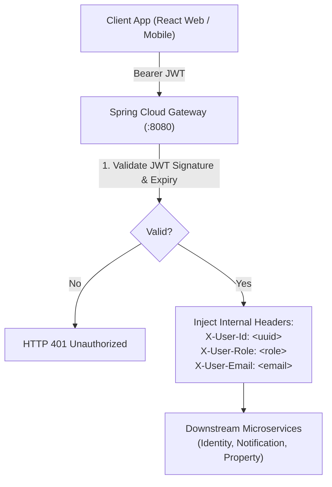

# Security Architecture & Gateway Integration

This reference manual outlines authentication, authorization, gateway routing, and header propagation patterns across Occupify microservices.

---

## 1. Edge Security Architecture

Occupify enforces a **Gateway-Centric Zero-Trust Boundary**:



1. **Authentication at the Edge**: External clients present Bearer JWT tokens exclusively to Spring Cloud Gateway.
2. **Context Enrichment**: The Gateway validates the token signature, decodes claims, strips client-injected `X-User-*` headers, and attaches verified internal headers:
   - `X-User-Id`: Subject UUID
   - `X-User-Role`: Authority role (e.g. `ROLE_TENANT`, `ROLE_LANDLORD`, `ROLE_ADMIN`)
   - `X-User-Email`: User's primary email
3. **Internal Microservices Trust Validated Headers**: Downstream microservices do not repeat computationally expensive public-key cryptographic token parsing. Instead, they ingest `X-User-*` headers directly into strongly typed Java contexts.

---

## 2. Strong Typing with `@Authenticated UserContext`

Instead of repetitive manual extraction of headers in every controller method, microservices implement an automated Spring MVC `HandlerMethodArgumentResolver`.

### 2.1 UserContext Record

```java
public record UserContext(
    UUID userId,
    String role,
    String email
) {
    public boolean hasRole(String targetRole) {
        return role != null && role.equalsIgnoreCase(targetRole);
    }

    public boolean isAdmin() {
        return hasRole("ROLE_ADMIN");
    }
}
```

### 2.2 Custom `@Authenticated` Annotation

```java
@Target(ElementType.PARAMETER)
@Retention(RetentionPolicy.RUNTIME)
@Documented
public @interface Authenticated {
    boolean required() default true;
}
```

### 2.3 Argument Resolver Implementation

```java
@Component
public class AuthenticatedUserArgumentResolver implements HandlerMethodArgumentResolver {

    @Override
    public boolean supportsParameter(MethodParameter parameter) {
        return parameter.hasParameterAnnotation(Authenticated.class)
                && parameter.getParameterType().equals(UserContext.class);
    }

    @Override
    public Object resolveArgument(MethodParameter parameter,
                                  ModelAndViewContainer mavContainer,
                                  NativeWebRequest webRequest,
                                  WebDataBinderFactory binderFactory) {
        Authenticated annotation = parameter.getParameterAnnotation(Authenticated.class);
        boolean required = annotation != null && annotation.required();

        String userIdHeader = webRequest.getHeader("X-User-Id");
        String roleHeader = webRequest.getHeader("X-User-Role");
        String emailHeader = webRequest.getHeader("X-User-Email");

        if (userIdHeader == null || userIdHeader.isBlank()) {
            if (required) {
                throw new UnauthorizedException("Missing required authentication header: X-User-Id");
            }
            return null;
        }

        try {
            UUID userId = UUID.fromString(userIdHeader);
            return new UserContext(userId, roleHeader, emailHeader);
        } catch (IllegalArgumentException ex) {
            throw new UnauthorizedException("Invalid X-User-Id UUID format");
        }
    }
}
```

### 2.4 Resolver Registration

```java
@Configuration
@RequiredArgsConstructor
public class WebMvcConfig implements WebMvcConfigurer {

    private final AuthenticatedUserArgumentResolver authenticatedUserArgumentResolver;

    @Override
    public void addArgumentResolvers(List<HandlerMethodArgumentResolver> resolvers) {
        resolvers.add(authenticatedUserArgumentResolver);
    }
}
```

### 2.5 Clean Controller Usage

```java
@GetMapping("/me")
public ResponseEntity<SingleResponse<UserProfileResponse>> getProfile(
        @Authenticated UserContext userContext) {
    UserProfileResponse profile = userService.getProfile(userContext.userId());
    return ResponseFactory.ok(profile, "Profile retrieved successfully");
}
```

---

## 3. OWASP Defensive Standards

1. **Input Validation**: Never trust raw HTTP payloads. Every request DTO must validate field lengths, numerical boundaries, email patterns, and non-blank states using `jakarta.validation`.
2. **CORS Configuration**: Restrict allowed origins to verified frontend domains in production. Never allow wildcard `*` with `AllowCredentials(true)`.
3. **Zero Information Leakage in Errors**: The `GlobalExceptionHandler` must NEVER expose Java stack traces, database schema column names, or internal class names in API responses.
4. **SQL Injection Immunity**: Always use Spring Data JPA repository query methods or parameterized JPQL queries. Never concatenate raw SQL strings.
