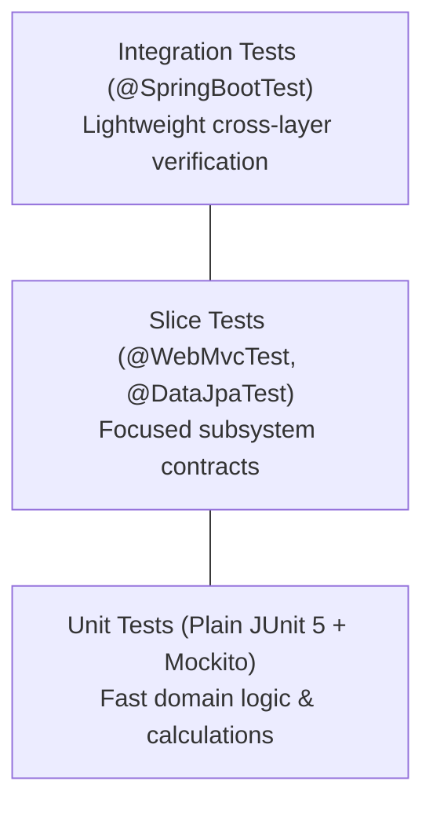

# Testing Strategy & Quality Gates

This reference manual provides testing methodologies, slice testing standards, and quality gate commands for Spring Boot 3 microservices.

---

## 1. Testing Pyramid & Slice Segregation

To maintain fast execution times and high test confidence, tests must be segregated into targeted slices:



### 1.1 Test Slice Taxonomy

| Test Slice | Annotation | What It Loads | What to Mock | Execution Speed |
| :--- | :--- | :--- | :--- | :--- |
| **Controller Slice** | `@WebMvcTest(TargetController.class)` | Spring MVC, Jackson, Security, Filters | `@MockBean` Services | Very Fast (~1-2s) |
| **Repository Slice** | `@DataJpaTest` | JPA Entities, Repositories, H2/Testcontainers | None (uses embedded/container DB) | Fast (~2-3s) |
| **Service Unit** | `@ExtendWith(MockitoExtension.class)` | Pure Java classes only (zero Spring context) | `@Mock` Repositories, Publishers | Instant (~50ms) |
| **Integration** | `@SpringBootTest` | Full ApplicationContext, real beans | External third-party APIs | Moderate (~5-10s) |

---

## 2. Controller Slice Testing (`@WebMvcTest`)

Controller slice tests verify:
1. HTTP status codes (200, 201, 400, 404, etc.).
2. Standard response envelope format (`SingleResponse`, `CreatedResponse`, `PageResponse`).
3. DTO validation rules (`@Valid` rejection of invalid emails, null fields, blank titles).
4. Correct delegation to underlying services.

### 2.1 Complete Controller Slice Recipe

```java
@WebMvcTest(NotificationController.class)
class NotificationControllerTest {

    @Autowired
    private MockMvc mockMvc;

    @Autowired
    private ObjectMapper objectMapper;

    @MockBean
    private NotificationService notificationService;

    @Test
    @DisplayName("POST /notifications should return 201 CreatedResponse when payload is valid")
    void createNotification_shouldReturn201() throws Exception {
        UUID id = UUID.randomUUID();
        CreateNotificationRequest request = new CreateNotificationRequest(
                UUID.randomUUID(),
                NotificationType.INFO,
                "Welcome",
                "Welcome to Occupify"
        );
        NotificationResponse response = new NotificationResponse(
                id, request.recipientId(), request.type(), request.title(), request.content(), false, Instant.now()
        );

        when(notificationService.createNotification(any(CreateNotificationRequest.class)))
                .thenReturn(response);

        mockMvc.perform(post("/notifications")
                        .contentType(MediaType.APPLICATION_JSON)
                        .content(objectMapper.writeValueAsString(request)))
                .andExpect(status().isCreated())
                .andExpect(jsonPath("$.status").value(201))
                .andExpect(jsonPath("$.message").value("Notification created successfully"))
                .andExpect(jsonPath("$.data.id").value(id.toString()))
                .andExpect(jsonPath("$.data.title").value("Welcome"));
    }

    @Test
    @DisplayName("POST /notifications should return 400 ErrorResponse when title is blank")
    void createNotification_withBlankTitle_shouldReturn400() throws Exception {
        CreateNotificationRequest invalidRequest = new CreateNotificationRequest(
                UUID.randomUUID(),
                NotificationType.INFO,
                "", // Blank title
                "Valid content"
        );

        mockMvc.perform(post("/notifications")
                        .contentType(MediaType.APPLICATION_JSON)
                        .content(objectMapper.writeValueAsString(invalidRequest)))
                .andExpect(status().isBadRequest())
                .andExpect(jsonPath("$.status").value(400))
                .andExpect(jsonPath("$.code").value("VALIDATION_ERROR"))
                .andExpect(jsonPath("$.details").isArray());
    }
}
```

---

## 3. Service Unit Testing (Mockito)

Service unit tests isolate pure domain logic without loading Spring ApplicationContext:

```java
@ExtendWith(MockitoExtension.class)
class NotificationServiceImplTest {

    @Mock
    private NotificationRepository notificationRepository;

    @Mock
    private NotificationMapper notificationMapper;

    @InjectMocks
    private NotificationServiceImpl notificationService;

    @Test
    @DisplayName("markAsRead should set read flag and timestamp when notification exists")
    void markAsRead_shouldSucceed() {
        UUID id = UUID.randomUUID();
        Notification entity = new Notification();
        entity.setId(id);
        entity.setRead(false);

        when(notificationRepository.findById(id)).thenReturn(Optional.of(entity));

        notificationService.markAsRead(id);

        assertThat(entity.isRead()).isTrue();
        assertThat(entity.getReadAt()).isNotNull();
        verify(notificationRepository).save(entity);
    }

    @Test
    @DisplayName("markAsRead should throw ResourceNotFoundException when notification missing")
    void markAsRead_whenMissing_shouldThrow() {
        UUID id = UUID.randomUUID();
        when(notificationRepository.findById(id)).thenReturn(Optional.empty());

        assertThatThrownBy(() -> notificationService.markAsRead(id))
                .isInstanceOf(ResourceNotFoundException.class);
    }
}
```

---

## 4. Repository Slice Testing (`@DataJpaTest`)

```java
@DataJpaTest
@AutoConfigureTestDatabase(replace = AutoConfigureTestDatabase.Replace.ANY)
class NotificationRepositoryTest {

    @Autowired
    private NotificationRepository repository;

    @Test
    @DisplayName("countByRecipientIdAndReadFalse should return correct unread count")
    void countUnread_shouldReturnAccurateCount() {
        UUID user = UUID.randomUUID();
        Notification n1 = createNotification(user, false);
        Notification n2 = createNotification(user, true);
        Notification n3 = createNotification(user, false);

        repository.saveAll(List.of(n1, n2, n3));

        long unread = repository.countByRecipientIdAndReadFalse(user);
        assertThat(unread).isEqualTo(2);
    }
}
```

---

## 5. Non-Negotiable Quality Gate

Before any branch commit or PR merge:
```bash
# 1. Clean build and run all test slices
./mvnw clean test

# 2. Verify all test reports are green
# Expected output:
# [INFO] Results:
# [INFO] Tests run: XX, Failures: 0, Errors: 0, Skipped: 0
# [INFO] BUILD SUCCESS
```

Any PR or commit containing a failing test (`Failures > 0` or `Errors > 0`) is strictly rejected.
