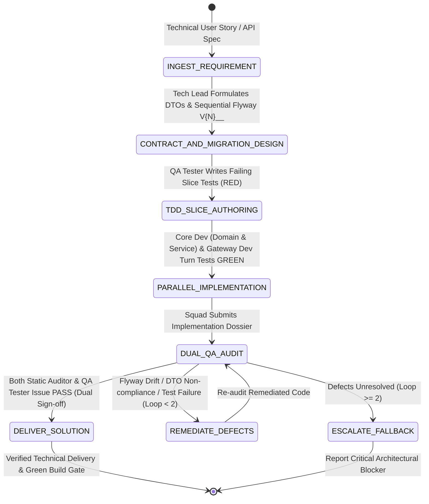

# Spring Boot 3 + Java 21 Consultation Workflow & Execution Protocols

This document defines the lifecycle phases, state machine transitions, audit rubric, and validation contracts for consulting on, scaffolding, and implementing Spring Boot microservices under `plugins/backend/`.

---

## 1. Runtime State Machine

The backend workflow is governed by a finite state machine (FSM) enforcing contract-first design, Flyway sequential increment verification, slice testing, and dual QA signoff with a deliberation loop limit of **2 review cycles**.



---

## 2. Phase-by-Phase Execution Logic

### Phase 1: `INGEST_REQUIREMENT` (`spring-tech-lead`)
1. Analyze user request, Jira ticket, or PRD requirements.
2. Determine microservice boundary: does this belong in `occupify-identity`, `occupify-noti`, or a new service?
3. Confirm database storage, messaging events, and external integration points.
4. Initialize review cycle counter: `review_cycle = 0`.

### Phase 2: `CONTRACT_AND_MIGRATION_DESIGN` (`spring-tech-lead`)
1. **API Contract Formulation**:
   - Define immutable Java 21 `record` DTOs with `jakarta.validation` constraints in `dto/`.
   - Specify endpoint URIs, HTTP verbs, and `ResponseFactory` wrapper types (`SingleResponse`, `CreatedResponse`, `PageResponse`, `SuccessResponse`).
2. **Flyway Migration Planning**:
   - Inspect existing migration scripts in `src/main/resources/db/migration/`.
   - Identify the highest sequence number `V{N}`.
   - Author new migration strictly as `V{N+1}__<description>.sql` (e.g., `V2__add_device_tokens.sql`).
   - Strictly REJECT timestamp versioning.
   - Ensure DDL operations follow the Expand and Contract pattern (no destructive column drops).

### Phase 3: `TDD_SLICE_AUTHORING` (`backend-qa-tester`)
1. Ingest DTO contracts and write failing slice tests:
   - `@WebMvcTest` controller slice asserting HTTP status codes, payload structure, validation violations (400), and `ResponseFactory` envelope.
   - Assert `Red State`: tests must fail due to missing controller methods or services.
2. Lock slice tests as contract guarantees for the implementation phase.

### Phase 4: `PARALLEL_IMPLEMENTATION` (`spring-core-dev` & `api-gateway-dev`)
1. **`spring-core-dev`**:
   - Implement `@Entity` with proper constraints and audit fields (avoiding Lombok `@Data`).
   - Implement Spring Data JPA `Repository`.
   - Implement `@Service` business logic with explicit `@Transactional` boundaries.
   - Implement MapStruct `@Mapper` for type-safe DTO conversions.
   - Publish asynchronous domain events via RabbitMQ if state changes require downstream notification.
2. **`api-gateway-dev`**:
   - Configure gateway route filters, path rewrites, and CORS policies if exposing new endpoints.
   - Ensure `X-User-Id` / `X-User-Role` headers are extracted and bound via `@Authenticated UserContext`.

### Phase 5: `DUAL_QA_AUDIT` (`backend-quality-auditor` & `backend-qa-tester`)
1. **Static Quality Audit (`backend-quality-auditor`)**:
   - Inspect Flyway migration naming: verify strictly sequential `V{N}__` format and zero timestamp migrations.
   - Check controller responses: verify all return `ResponseEntity<...Response>` from `ResponseFactory`.
   - Verify absence of raw entity leaks, `@Data` on entities, and inline SQL in controllers.
   - Verify RabbitMQ consumer idempotency and DLX/DLQ configuration.
2. **Dynamic Verification (`backend-qa-tester`)**:
   - Run `./mvnw clean test` locally or in container.
   - Verify all tests pass (GREEN) with 0 errors, 0 failures.
3. **Branch Decision**:
   - **PASS**: If both auditors sign off, transition to `DELIVER_SOLUTION`.
   - **FAIL (cycle < 2)**: Transition to `REMEDIATE_DEFECTS`, increment `review_cycle`, and notify developers.
   - **FAIL (cycle >= 2)**: Transition to `ESCALATE_FALLBACK` with detailed blocking diagnostic report.

---

## 3. Dual-QA Audit Rubric

| Category | Check Item | Severity | Pass Criteria |
| :--- | :--- | :--- | :--- |
| **Migrations** | Sequential increment naming | CRITICAL | Starts with `V{N+1}__`, NO timestamp numbers (`V2026...`). |
| **Migrations** | Non-destructive DDL | CRITICAL | No immediate `DROP COLUMN` or breaking type alterations. |
| **API Contract** | Standard Response Envelope | CRITICAL | Uses `ResponseFactory.ok/created/page/error/success`. |
| **API Contract** | DTO Immutability | MAJOR | Java 21 `record` with `jakarta.validation` annotations. |
| **Architecture** | Layer Separation | CRITICAL | No business logic in `@RestController`; Service holds transactions. |
| **Architecture** | Entity Hygiene | MAJOR | No `@Data` on JPA entities; explicit `@Getter`, `@Setter`. |
| **Security** | Identity Propagation | CRITICAL | Gateway token validation; downstream uses `@Authenticated`. |
| **Messaging** | Resilience & DLQ | MAJOR | RabbitMQ consumers have DLX/DLQ and idempotency check. |
| **Testing** | Zero-Failure Build | CRITICAL | `./mvnw clean test` passes 100% with zero failures. |

---

## 4. Verification & Delivery Commands

Before delivering any backend modification:
```bash
# 1. Verify Flyway migrations follow strictly sequential increment numbering
ls -1 src/main/resources/db/migration/*.sql | grep -E '^.*db/migration/V[0-9]+__[a-z0-9_]+\.sql$'

# 2. Check for prohibited timestamp migration patterns (must return empty)
ls -1 src/main/resources/db/migration/*.sql | grep -E 'V202[0-9]' && echo "ERROR: Timestamp migration detected!"

# 3. Execute Maven clean test suite
./mvnw clean test

# 4. Check git status to ensure no temporary test artifacts remain uncommitted
git status --short
```
