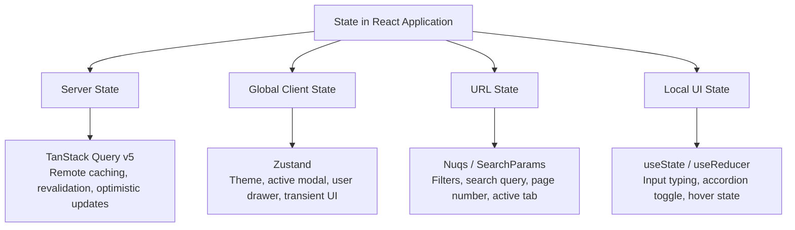

# State Management Taxonomy & Strategies

A common failure mode in React applications is using a single state management tool for every type of state. Modern best practice dictates dividing state into **four distinct categories**.

---

## 1. The Four Categories of State



---

## 2. Server State: TanStack Query v5

### Query Key Factory Pattern
Centralize query keys to prevent typo-driven cache invalidation bugs:

```typescript
// src/features/properties/api/query-keys.ts
export const propertyKeys = {
  all: ['properties'] as const,
  lists: () => [...propertyKeys.all, 'list'] as const,
  list: (filters: Record<string, unknown>) => [...propertyKeys.lists(), filters] as const,
  details: () => [...propertyKeys.all, 'detail'] as const,
  detail: (id: string) => [...propertyKeys.details(), id] as const,
};
```

### Type-Safe Query Hook
```typescript
// src/features/properties/api/get-properties.ts
import { useQuery } from '@tanstack/react-query';
import { apiClient } from '@/lib/api-client';
import { propertyKeys } from './query-keys';
import type { Property, PropertyFilterParams } from '../types';

async function fetchProperties(params: PropertyFilterParams): Promise<Property[]> {
  const response = await apiClient.get<Property[]>('/properties', { params });
  return response.data;
}

export function useProperties(params: PropertyFilterParams) {
  return useQuery({
    queryKey: propertyKeys.list(params),
    queryFn: () => fetchProperties(params),
    staleTime: 1000 * 60 * 5, // 5 minutes fresh
  });
}
```

### Optimistic Mutation
```typescript
// src/features/properties/api/bookmark-property.ts
import { useMutation, useQueryClient } from '@tanstack/react-query';
import { apiClient } from '@/lib/api-client';
import { propertyKeys } from './query-keys';

export function useBookmarkProperty(propertyId: string) {
  const queryClient = useQueryClient();

  return useMutation({
    mutationFn: () => apiClient.post(`/properties/${propertyId}/bookmark`),
    onMutate: async () => {
      await queryClient.cancelQueries({ queryKey: propertyKeys.detail(propertyId) });
      const previous = queryClient.getQueryData(propertyKeys.detail(propertyId));

      queryClient.setQueryData(propertyKeys.detail(propertyId), (old: any) => ({
        ...old,
        isBookmarked: true,
      }));

      return { previous };
    },
    onError: (_err, _vars, context) => {
      if (context?.previous) {
        queryClient.setQueryData(propertyKeys.detail(propertyId), context.previous);
      }
    },
    onSettled: () => {
      queryClient.invalidateQueries({ queryKey: propertyKeys.detail(propertyId) });
    },
  });
}
```

---

## 3. Global Client State: Zustand

Zustand should be reserved strictly for non-server client state.

```typescript
// src/stores/ui-store.ts
import { create } from 'zustand';

interface UIState {
  sidebarOpen: boolean;
  activeModal: string | null;
  toggleSidebar: () => void;
  openModal: (modalId: string) => void;
  closeModal: () => void;
}

export const useUIStore = create<UIState>((set) => ({
  sidebarOpen: true,
  activeModal: null,
  toggleSidebar: () => set((state) => ({ sidebarOpen: !state.sidebarOpen })),
  openModal: (modalId) => set({ activeModal: modalId }),
  closeModal: () => set({ activeModal: null }),
}));

// ✅ Re-render optimization: always select specific properties
export const useSidebarOpen = () => useUIStore((s) => s.sidebarOpen);
```

---

## 4. URL State: Deep-Linkable Filters

Filter criteria must stay in the URL so that users can bookmark and share links.

```typescript
// src/features/properties/hooks/use-property-filters.ts
import { useSearchParams } from 'react-router-dom';

export function usePropertyFilters() {
  const [searchParams, setSearchParams] = useSearchParams();

  const city = searchParams.get('city') || 'all';
  const minPrice = searchParams.get('minPrice') ? Number(searchParams.get('minPrice')) : 0;

  const setCity = (newCity: string) => {
    searchParams.set('city', newCity);
    setSearchParams(searchParams);
  };

  return { city, minPrice, setCity };
}
```
