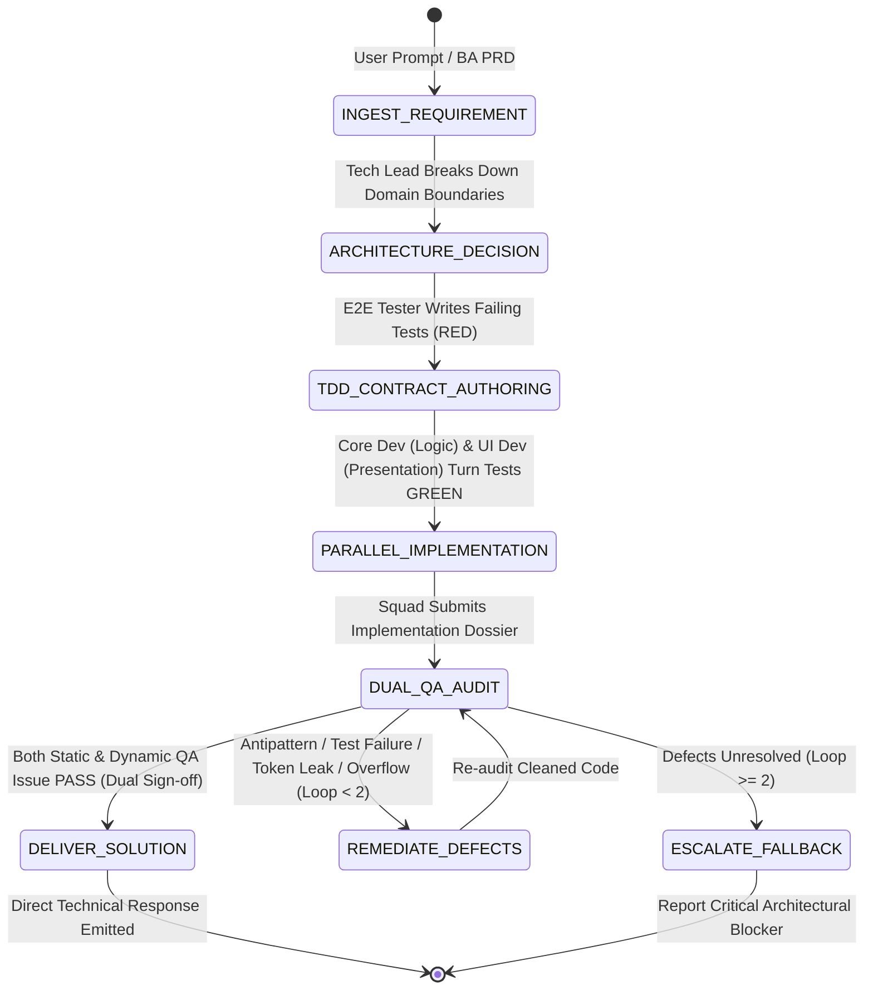

# React + Vite Consultation Workflow & Execution Protocols

This document defines the lifecycle phases, state machine transitions, audit rubric, and validation contracts for consulting on and scaffolding React + Vite projects under `.agents/react/`.

---

## 1. Runtime State Machine

The workflow is orchestrated through a finite state machine (FSM) enforcing a mandatory **TDD-Inversion & Dual-QA Verification Protocol** across the specialized React squad with a maximum deliberation loop limit of **2 review cycles**.

---

## 2. Phase-by-Phase Execution Logic

### Phase 1: `INGEST_REQUIREMENT` (`product-researcher-ba`)
1. Conduct market and competitor discovery if requested (`search_web`, `read_url_content`).
2. Synthesize structured User Stories and Gherkin Acceptance Criteria.
3. Initialize review cycle counter: `review_cycle = 0`.

### Phase 2: `ARCHITECTURE_DECISION` (`react-tech-lead`)
1. **Module Placement**: Enforce [Bulletproof React](references/project-structure.md) under `src/features/<feature>/`.
2. **State Tiering**: Classify Server, Client Global, URL, or Local UI state.
3. **Pattern Selection**: Choose Compound Components, Headless Custom Hooks, or Slot Composition.

### Phase 3: `TDD_CONTRACT_AUTHORING` (`react-e2e-tester`)
1. Ingest Gherkin AC and write failing test suite in `src/features/<feature>/__tests__/<feature>.test.tsx` (Vitest + RTL).
2. Establish the **Red State**: tests must fail due to missing components or unhandled state transitions.
3. Lock the test suite as an immutable contract (developers may not modify test assertions).

### Phase 4: `PARALLEL_IMPLEMENTATION` (`react-core-dev` & `react-ui-dev`)
1. **`react-core-dev`**:
   - Pure TypeScript types in `types/` (zero runtime constants).
   - Zod validation schemas and async callers in `api/`.
   - TanStack Query hooks in `hooks/` and Zustand stores in `src/stores/`.
2. **`react-ui-dev`**:
   - Compound UI components with guarded Context hooks.
   - 100% semantic Tailwind design tokens (zero arbitrary brackets like `bg-[#...]`).
   - UI resilience (button mutation disabling, error boundaries, empty states).
3. Achieve **Green State**: code runs until all test assertions pass.

### Phase 5: `DUAL_QA_AUDIT` (`react-static-auditor` & `react-e2e-tester`)
An independent dual-agent audit performed before user delivery:
- [ ] **Pure Types & Zod Schemas**: `types/` has 100% pure types; all `api/` endpoints parse with Zod.
- [ ] **Design Token Guardian**: Zero arbitrary Tailwind values (`[#...]`, `[...px]`).
- [ ] **Public Boundary Gatekeeper**: No external imports pierce internal feature subdirectories; only consumed via feature `index.ts`.
- [ ] **Context Safety**: All compound subcomponents call a custom hook that checks for null context.
- [ ] **TDD Green Suite**: 100% pass rate in Vitest automated tests without modifying test files.
- [ ] **Visual Layout Integrity**: No horizontal scroll overflow at 375px mobile viewport; clear `:focus-visible` rings.
- [ ] **Chaos Resilience**: Graceful handling of long strings, double-click spam, and simulated HTTP 500.
- [ ] **Deprecation Clearance**: Zero `@deprecated` symbols used from third-party libraries.
- [ ] **Linter & Type Cleanliness**: Zero warnings or errors in `oxlint` and `tsc -b`.

If any check fails and `review_cycle < 2`:
- Transition to `REMEDIATE_DEFECTS` with targeted remediation notes. Increment `review_cycle`.
When all checks PASS:
- Both agents issue **DUAL_SIGNOFF** and transition to `DELIVER_SOLUTION`.

### Phase 6: `DELIVER_SOLUTION`
Render the complete architecture, configuration file, or component implementation cleanly with zero conversational filler, followed by canonical references.

---

## 3. Architecture Audit Rubric

| Checkpoint | Target | Pass Condition | Failure Action |
| :--- | :--- | :--- | :--- |
| **Dumb Data Isolation** | Feature structure | `types/` contains 100% pure types. All dumb/mock data (`MOCK_*`) and mock callers reside in `api/`. Components do not hardcode mock lists. | Move mock datasets from `types/` or `components/` into `api/`. |
| **Dual-Agent Sign-off** | Review Protocol | At least 2 distinct agent roles (`ReactArchitectAgent` + `PatternAuditorAgent`) verified the solution. | Trigger independent auditor review. |
| **Scope Restraint** | Workspace Init | Only skeleton, `.gitkeep`, sample configs (`router`, `env`), and sample `home.tsx` created. | Remove premature mock feature code. |
| **Deprecation** | Imports / APIs | Zero `@deprecated` symbols from installed libraries (`@phosphor-icons/react`, React, etc.). | Check official docs / `.d.ts` and replace with active symbol. |
| **Colocation** | Feature code | API calls, hooks, and types reside within the feature folder. | Move scattered files into the feature directory. |
| **Encapsulation** | `index.ts` | Only public components/hooks are exported; internals remain unexported. | Restrict exports in `index.ts`. |
| **Context Safety** | Compound UI | `useContext` hook throws descriptive error when accessed outside Provider. | Add context guard check. |
| **State Hygiene** | Remote data | Fetched via TanStack Query; no `useEffect` + `setState` data fetching. | Refactor to `useQuery` / `useMutation`. |
| **Chunk Hygiene** | Vite build | Large vendor dependencies are isolated in `build.rollupOptions.output.manualChunks`. | Update `vite.config.ts`. |

---

## 4. Edge Cases & Fallback Matrix

| Edge Case | Solution / Rule |
| :--- | :--- |
| **Cross-Feature Communication** | If Feature A needs data from Feature B, export an API hook or shared store from Feature B's `index.ts`. Never cross-import internal components. |
| **Circular Dependencies** | Extract shared models or utilities to top-level `src/types/` or `src/utils/`. |
| **Legacy React 16/17 Codebase** | Highlight the migration path to modern functional paradigms, hooks, and Vite bundling before refactoring. |
| **Dumb Data vs Type Collision** | When a feature has a predefined list of options (e.g. `SCHOOL_OPTIONS`), define the TypeScript type in `types/` (e.g. `type SchoolOption = string`) and place the actual mock array `MOCK_SCHOOL_OPTIONS` in `api/`. Never place the runtime array in `types/`. |
